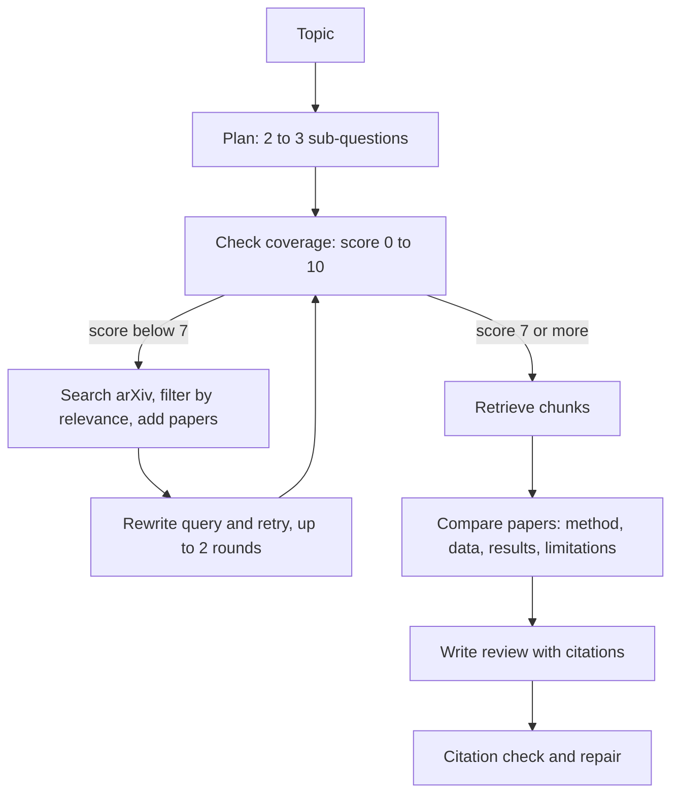
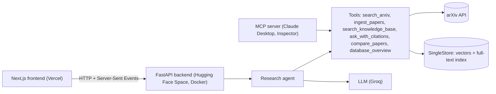

# Research Paper Agent

An **agentic RAG** system that turns a research topic into a **literature review with claim-level citations**.
It plans sub-questions, checks what its database already knows, pulls new papers from arXiv when there are
gaps, compares the papers, writes the review, and then checks its own citations.

- **Live demo:** https://ra-wine-chi.vercel.app  *(the backend sleeps when idle, so the first load can take about a minute; past reviews are open to everyone, live agent runs need an access code)*
- **Built with:** Python, FastAPI, SingleStore (vector + full-text search), Next.js, TypeScript, MCP

<!-- Add 2-3 screenshots here: the live agent activity feed, and a review with a citation highlighted -->
<!--  -->
<!--  -->

## What it does

- **Hybrid search** over paper chunks: semantic (vector) and keyword (full-text) search in a single SingleStore database, merged with Reciprocal Rank Fusion.
- **A real multi-step agent**, not a fixed pipeline. It decides on its own whether to search for more papers, rewrites its query when a search does not help, and filters candidates by relevance before adding them.
- **Claim-level citations.** Every factual sentence ends with source numbers. Click one and the page jumps to the exact text chunk that was used.
- **Automatic citation checks**: missing, invalid, and (in evaluation) unsupported citations are detected.
- **Live activity feed.** Agent steps stream to the browser while it works.
- **MCP server** that exposes the same 7 tools to Claude Desktop, Cursor, or the MCP Inspector.
- **Evaluation scripts** that measure retrieval quality and citation faithfulness (results below).

## How the agent works



## Architecture



The tools are written once and shared by the agent, the web API and the MCP server.

## Evaluation

All numbers come from the scripts in `evaluation/` and can be reproduced. Setup: LLM `openai/gpt-oss-20b` on Groq,
embeddings `BAAI/bge-small-en-v1.5` (384 dimensions), database of 75 papers and 3,159 chunks.

### 1. Retrieval quality (15 questions)

Questions were drafted by an LLM from random passages in the database and then reviewed by hand. The correct
answer is the paper the passage came from.

| Search mode | Recall@1 | Recall@3 | Recall@5 | Recall@10 | MRR | Chunk R@10 |
|---|---|---|---|---|---|---|
| Vector | 66.7% | 86.7% | 93.3% | 100.0% | 0.794 | 80.0% |
| Keyword | 86.7% | 93.3% | 100.0% | 100.0% | 0.917 | 86.7% |
| Hybrid (vector + keyword) | 93.3% | 93.3% | 93.3% | 100.0% | 0.944 | 93.3% |

**Reading the table:** hybrid search gave the best top-1 accuracy and the best MRR, and it found the exact source
passage most often. With only 15 questions, one question is worth 6.7 points, so the gap between keyword and
hybrid at Recall@5 is a single question. The questions come from passages inside the database, which favours
keyword matching, so real user questions would likely be harder.

### 2. Citation faithfulness

An LLM judge checked, for every cited sentence, whether the cited chunk supports it.

| Group | Answers | Claims judged | Citation coverage | Faithful (strict) | Faithful (supported + partial) | Invalid citations |
|---|---|---|---|---|---|---|
| Plain RAG answers | 10 | 28 | 79.1% | 78.6% | 100.0% | 0.0% |
| Agent literature reviews | 3 | 34 | 86.5% | 64.7% | 82.4% | 1.0% |

**Reading the table:** short single-pass RAG answers were easier to ground than the agent's multi-source reviews.
Synthesising across many sources is where unsupported claims creep in, and this is the main weakness of the
system. The current repair step only checks that citations exist, not that they are correct (see Future work).

_Judge reliability: I checked 10 judgments by hand and agreed with the judge on **X of 10**._ <!-- TODO: replace X after doing the spot-check in evaluation/results/faithfulness_spotcheck.md -->

### Limitations of this evaluation

- Test questions are LLM-drafted from the database itself, so they are easier than real questions.
- Each question has one correct paper, but similar papers may also answer it, so Recall is slightly underestimated.
- The faithfulness judge is an LLM from the same family that wrote the answers.
- Samples are small (15 questions, 3 reviews). Treat the numbers as indicative, not as a benchmark.

Reproduce: `python evaluation/make_testset.py`, then `eval_retrieval.py`, `eval_faithfulness.py`, and `make_report.py`.

## Run it locally

**Needs:** Python 3.11+, Node.js 20+, a SingleStore workspace, and an LLM key (Groq free tier works).

```bash
# 1. Backend
python -m venv venv
venv\Scripts\activate            # macOS/Linux: source venv/bin/activate
pip install -r requirements.txt
cp .env.example .env             # then fill in your SingleStore and LLM details

python ingest.py "LLM hallucination mitigation" --max 20   # creates tables, downloads and chunks papers
python setup_search.py                                     # adds the vector column and full-text index
python embed_chunks.py                                     # creates embeddings
uvicorn api:app --port 8000

# 2. Frontend (new terminal)
cd frontend
npm install
npm run dev                       # http://localhost:3000
```

Or use the agent straight from the command line:
`python agent.py "impact of noisy data on language model performance"`

### Configuration

| Variable | Meaning |
|---|---|
| `S2_HOST`, `S2_PORT`, `S2_USER`, `S2_PASSWORD`, `S2_DATABASE` | SingleStore connection |
| `LLM_PROVIDER` | `groq`, `ollama`, `gemini` or `anthropic` |
| `LLM_MODEL` | model name (optional, has a default per provider) |
| `GROQ_API_KEY` (or the key for your provider) | LLM credentials |
| `AGENT_ACCESS_CODE` | if set, running the agent requires this code (public demos) |
| `ASK_LIMIT_PER_HOUR` | questions per visitor per hour for `/api/ask` |
| `ALLOWED_ORIGINS` | websites allowed to call the API (comma separated) |
| `NEXT_PUBLIC_API_URL` | (frontend) address of the backend |

## Use it from Claude Desktop (MCP)

```bash
python test_mcp.py          # starts the server and lists the 7 tools
mcp dev mcp_server.py       # opens the MCP Inspector in the browser
```

For Claude Desktop, copy `claude_desktop_config.example.json` into your Claude config and fix the paths.

## Deployment

- **Database:** SingleStore Helios workspace.
- **Backend:** Docker container on a Hugging Face Space (free CPU, 16 GB RAM). Build the folder with
  `python deploy/build_space_folder.py`. Secrets are set in the Space settings, never in the repo.
- **Frontend:** Vercel, with the project root set to `frontend/` and `NEXT_PUBLIC_API_URL` pointing at the Space.
- **Public-demo protections:** access code for agent runs, per-visitor rate limit on questions, one agent run
  at a time, restricted CORS, and a database user limited to this one database.

## Project structure

```
api.py                FastAPI backend (REST + live streaming)
agent.py              the research agent loop
tools.py              the 6 tools (shared by agent, API and MCP server)
rag.py, search.py     retrieval, hybrid search, cited answers
ingest.py, pdf_parser.py, arxiv_tool.py, embed_chunks.py, embedder.py   paper ingestion pipeline
mcp_server.py         MCP server
llm.py, llm_json.py   LLM provider switch and JSON helpers
evaluation/           test set generation and evaluation scripts
deploy/               Dockerfile and Hugging Face bundle builder
frontend/             Next.js app (TypeScript, Tailwind)
```

## Design decisions

- **Plain Python agent loop instead of a framework.** The flow is simple enough that a framework would hide the
  logic. Every step is visible, testable, and streams its progress.
- **One database for vectors and full-text.** SingleStore handles both, which allows hybrid search without
  running a separate vector database.
- **Reciprocal Rank Fusion** to merge rankings, because vector and keyword scores are on different scales.
- **Streaming with Server-Sent Events** so the user sees the agent work during a multi-minute run.
- **Tools written once.** The same functions serve the agent, the HTTP API and the MCP server.

## Limitations and future work

- Papers come from arXiv only, in English, mostly computer science. Quality varies on unfamiliar topics.
- PDF section detection is heuristic (headings matched by pattern), so some papers are chunked imperfectly.
- All topics share one database, so unrelated papers can accumulate. Per-topic collections would fix this.
- Agent reviews are less faithful than short RAG answers. Next step: verify each citation with the judge during
  generation and rewrite or drop unsupported sentences.
- No reranker yet. A cross-encoder over the top hybrid results would likely improve precision.
- Evaluation sets are small. A larger, human-labelled set would give firmer conclusions.
